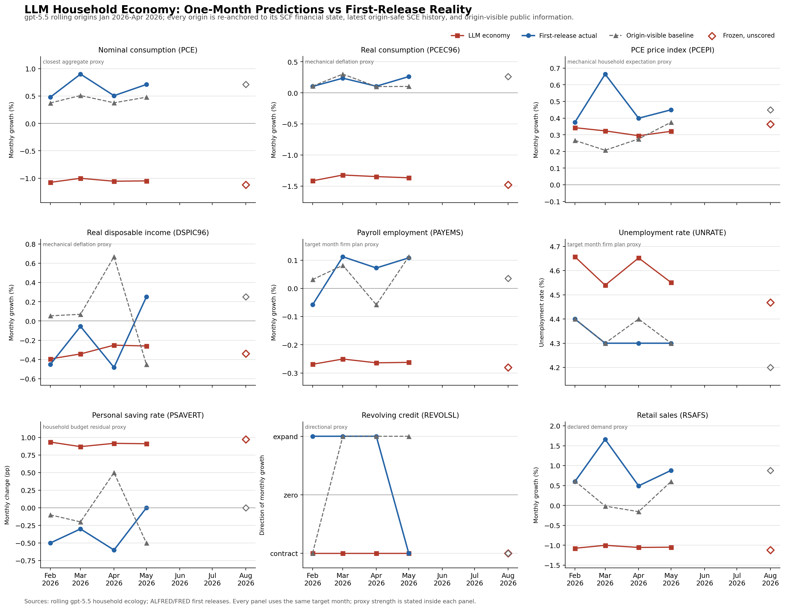

# Macro LLM Tournament



The current result at a glance: four rolling one-month forecasts for nine declared
macro outputs, plus the frozen and unscored August forecast. Red is the LLM household
economy, blue is first-release reality, and gray is the information-visible baseline.

This repository contains a runnable 200-household LLM economy. Real SCE histories
supply household priors, matched SCF records supply continuous financial states,
GPT-5.5 writes conditional household policies in dollars, and ordinary code settles
budgets and counterparties. A small producer turns household demand into output,
inventory, employment, wages, and family income before the households decide again.

The latest repaired-population evaluation is a clean negative on forecast value. Its
predicted-versus-first-release-actual panel covers nine macro variables across four
retrospective monthly origins. Only executed nominal household consumption has a close
aggregate counterpart: nominal PCE. On that central comparison, the household economy
has RMSE `1.703` percentage points and gets no directions right, while the
origin-visible PCE drift supplied to every household has RMSE `0.243`, correlation
`0.974`, and 4/4 direction. The economy is genuinely generated by household actions,
but the household layer has not added signal beyond the information in its prompt.

## Active Economy

```text
200 anonymized SCE histories + matched SCF financial states
                              +
                 public information known at the origin
                              |
                              v
                one isolated GPT-5.5 call per household
                              |
                              v
       beliefs + employed/not-employed policies in nominal dollars
                              |
                              v
          household budgets, credit, and settlement
                              |
                              v
                    population-weighted demand
                              |
                              v
     producer output + inventory -> employment + wages -> family income
                              |
                              v
               fresh period-two household decisions
```

Each rolling origin receives the latest SCE observations that would have been public
at that date. The public information card includes recent aggregate spending as
context, but it does not add that growth to household spending before the LLM acts.
The producer is deliberately mechanical. There are no LLM firms or banks.

## Latest Diagnostic: Nominal Consumption

| Origin | Target | LLM household economy | First-release PCE | Origin-visible drift |
| --- | --- | ---: | ---: | ---: |
| Jan 2026 | Feb 2026 | -1.08% | +0.48% | +0.37% |
| Feb 2026 | Mar 2026 | -1.00% | +0.90% | +0.51% |
| Mar 2026 | Apr 2026 | -1.06% | +0.51% | +0.38% |
| Apr 2026 | May 2026 | -1.05% | +0.71% | +0.48% |

- Consumption RMSE: **1.703 pp**.
- Mean bias: **-1.696 pp**.
- Consumption direction: **0/4**.
- Origin-visible drift RMSE: **0.243 pp**.
- Origin-visible drift demeaned RMSE: **0.113 pp**.
- Origin-visible drift correlation: **0.974**.
- Origin-visible drift direction: **4/4**.

The frozen July-to-August nominal-consumption forecast is **-1.12%**. August remains
unscored. In the unscored recursive run, fresh period-two household spending falls
**0.80%** from period one while producer employment and wages barely move. This proves
the state transition executes; it is not a September forecast or evidence that
feedback improves accuracy.

## Nine-Variable Prediction Surface

The current panel shows predictions, origin-visible baselines, and first-release
actuals for nominal PCE, PCEPI, real PCE, real disposable income, payrolls,
unemployment, personal saving, revolving credit, and retail sales. It expands
observability; it does not turn every plotted series into an equally valid macro
forecast target.

| Model output | First-release comparator | Interpretation boundary |
| --- | --- | --- |
| Nominal consumption growth | nominal PCE | closest aggregate proxy; the primary result |
| Price growth | PCEPI | household-belief/deflation proxy |
| Real consumption growth | real PCE | belief/deflation proxy |
| Real disposable income growth | real disposable income | belief/deflation proxy |
| Payroll growth; unemployment level | PAYEMS; UNRATE | target-month producer-plan proxies using origin inventory |
| Saving-rate change | PSAVERT | gross household budget-residual proxy, not national saving |
| Revolving-credit growth | revolving credit | direction-only proxy |
| Retail-sales growth | retail sales | declared demand proxy |

All nine retrospective comparisons have `n=4`; they are development diagnostics, not
confirmatory evidence. The secondary rows show where the household beliefs, accounting
residual, and declared producer plan land relative to first releases. They do not validate
the belief-to-real mapping, identify a labor market, establish a national-accounts
saving model, or supply incremental forecast evidence. The consumption failure remains
the central finding.

## Macro JEPA Companion

A fresh StructuredStateJEPA now learns from the full origin-safe release stream rather
than one monthly snapshot. Canonical initial releases and value-changing revisions are
grouped into **4,958 atomic release days** through the final evaluation cutoff; the model trains through 2021, selects its
residual readout on 2022-2023, and leaves a 24-origin 2024-2025 block untouched until
scoring. A unit audit found and repaired a 1,000-fold unit change in the archived
consumer-credit levels before the current run. On the untouched block, nominal-PCE
RMSE is now **0.458 pp**, versus **0.331 pp** for the origin-visible lag-1 baseline
and **0.234 pp** for the frozen historical median. The event-level redesign is much
less wrong after the record repair, but it still does not establish superior PCE skill.

On the four 2026 household-comparison origins, Event-JEPA scores **0.256 pp**, versus
**1.703 pp** for the repaired LLM household economy and **0.243 pp** for lag-1. Its
direct state ridge scores **0.413 pp** rather than exploding on mixed units. These four
origins are too few to distinguish Event-JEPA from lag-1; the 24-origin block remains
the more informative test.

This is a macro-only companion benchmark, not an LLM-HANK-JEPA hybrid. The current
household ecology has only four realized aggregate paths, so using it to train a
hybrid would not be credible. The plotted green series is specifically a next-release
JEPA-predicted latent followed by a validation-shrunk residual ridge readout. It has no August marker
because the dense archive does not provide a complete July 10 macro state. The
comparison figure is
[`reports/current_macro_jepa_comparison.png`](reports/current_macro_jepa_comparison.png).
The exact scores, split contract, normalization rules, input hashes, primary readout
selection, and generator-source hashes are tracked in
[`reports/current_macro_jepa_evidence.json`](reports/current_macro_jepa_evidence.json).
The exact modified VEI training runtime used by the locked run is reproducible from
base commit `682a369` plus
[`vendor/vei_macro_jepa_runtime_682a369.patch`](vendor/vei_macro_jepa_runtime_682a369.patch);
the evidence bundle records and verifies every dependency-file hash.

## Run It

```bash
make ecology-history
make ecology-current-replay
make ecology-retrospective-replay
make ecology-feedback-replay
make ecology-observability
make macro-jepa
make check
make test
```

Fresh model calls use Codex CLI only:

```bash
make ecology-live-200
make ecology-retrospective-live
make ecology-feedback-live
```

Every model call runs in an empty directory without local-file, shell, web, browser,
app, memory, plugin, or subagent access. Replays bind the public history, prompt,
cards, accepted payloads, parent artifacts, source inputs, executable source, and
economic result.

## Evidence Boundary

- January-April 2026 is retrospective development evidence and may be in model
  knowledge.
- The July 2026 origin is frozen for August and remains unscored.
- Household budgets, goods inventory, bank stocks, and named counterparty flows
  reconcile. A firm balance sheet and full external sector are not modeled.
- V22's apparent 4/4 directional result is retired. It inherited origin-visible PCE
  growth in the household spending baseline before the model acted.
- V24 repairs SCF donor matching and population concentration. Its household forecast still loses to the visible PCE
  context on level, timing, and direction.
- V5 financial inputs preserve SCF's observed composite revolving payment for audit
  but give the executable card balance the same 3%/$25 minimum-payment contract as
  the simulation. A new household run has not yet been scored on V5.
- The nine-variable surface is retrospective (`n=4`). August is a frozen,
  unscored prospective panel row.

See [CURRENT.md](CURRENT.md) for the current milestone,
[reports/current_ecology_report.md](reports/current_ecology_report.md) for the
sendable result, and [research_history.md](research_history.md) for the experiment
trail. The panel data and generated figures are in
`outputs/household_ecology_observability_v24/`. The previous weighted-demand economy is recoverable at Git tag
`macro-v1-weighted-demand`.
