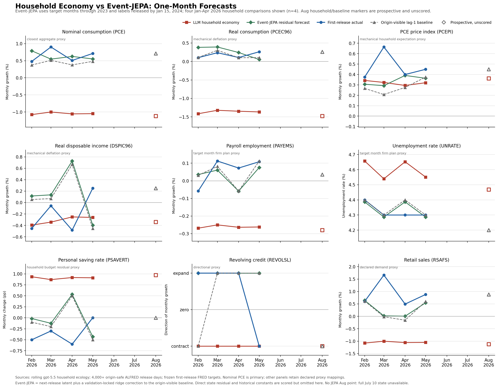

# The Household Economy Is Now Representative, But Its Behavior Is Too Pessimistic

The current 200-household economy has credible population arithmetic, complete
accounting, and a working feedback loop. It does not yet forecast macro behavior
well. Repairing a serious household-matching problem made the forecast failure
larger and easier to diagnose.

## The Repair

Each simulated household begins with a real, anonymized SCE history. SCF records
supply the detailed balance-sheet shape that SCE does not contain. The previous
matching procedure used broad demographic groups and could assign an extreme SCF
donor to an ordinary SCE household. One $135,000-income survey household inherited
a $21.9 million donor state and accounted for 31.3% of baseline spending.

V24 keeps the SCE household's income level, accepts only SCF donors with income from
one-half to twice that anchor, and scales the donor's dollar flows and stocks to the
anchor. The resulting population passes fixed concentration checks:

| Population check | V23 | V24 |
| --- | ---: | ---: |
| Largest spending contribution | 31.3% | 2.36% |
| Top-five contribution | 46.5% | 8.87% |
| Effective spending households | 9.2 | 140.4 |

All 200 households found a bounded donor without relaxing their demographic match.
The reporting layer also fails closed if any run was generated from a different
household file.

A subsequent input audit found one more error: SCF `REVPAY` is an observed composite
of card, buy-now-pay-later, and revolving-line payments, not the contractual minimum
on the card balance modeled here. The prepared V5 input retains that observation for
audit but executes the simulation's actual 3%/$25 card minimum. It keeps the same 200
households and the same donors; 109 payment fields change. The forecast below remains
the completed V24 run and has not been relabeled as a V5 result.

## The Forecast Result

The repair does not rescue the model. It reveals a stronger behavioral failure.

| Origin | Target | LLM household economy | First-release PCE | Visible-data baseline |
| --- | --- | ---: | ---: | ---: |
| Jan 2026 | Feb 2026 | -1.08% | +0.48% | +0.37% |
| Feb 2026 | Mar 2026 | -1.00% | +0.90% | +0.51% |
| Mar 2026 | Apr 2026 | -1.06% | +0.51% | +0.38% |
| Apr 2026 | May 2026 | -1.05% | +0.71% | +0.48% |

| Diagnostic | LLM household economy | Visible-data baseline |
| --- | ---: | ---: |
| Nominal PCE RMSE | 1.703 pp | 0.243 pp |
| Mean error | -1.696 pp | -0.215 pp |
| Direction | 0/4 | 4/4 |

At every origin, roughly four-fifths of represented households choose to reduce
spending. Settlement constraints materially bind for only about 0.7% of them. The
downward bias therefore comes from the LLM-authored household policies rather than
from cash, credit, or accounting restrictions.

## What The Economy Does

Each household receives its own prior beliefs, financial state, and public information
available at the forecast date. GPT-5.5 returns beliefs and conditional dollar policies
for spending, borrowing, and debt repayment. Deterministic code settles those choices,
aggregates demand, adjusts producer output and inventory, maps demand into employment
and wages, and feeds the resulting income and balance sheets into a fresh household
decision.

The repaired July origin predicts a **1.12% fall** in August nominal consumption.
That point is frozen and unscored until the first-release August data arrive. The
two-period mechanism then produces a further **0.80% fall** in spending. All household,
goods, bank, and counterparty accounts reconcile to numerical tolerance, and the
published feedback run is an exact replay of the live run.

This establishes that the dynamic system runs. It does not establish predictive value.

## The JEPA Comparison

The green series in the figure is the Event-JEPA forecast. A data audit found a
1,000-fold unit change in two archived consumer-credit series and the same raw-unit
ingress in exact 2026 cards. V3 canonicalizes both sources and fails closed on any
remaining mixed unit. On the four 2026 nominal PCE targets its RMSE is **0.256 pp**,
close to the visible-data baseline's **0.243 pp** and better than the historical
median's **0.317 pp**. Its direct state ridge is now finite at **0.413 pp**.

The more informative locked 2024-2025 result remains negative: Event-JEPA scores
**0.458 pp**, lag-one **0.331 pp**, and the historical median **0.234 pp**. The record
repair makes JEPA competitive on four current months; it does not establish a durable
forecasting advantage.

The current evidence does not support the household economy or Event-JEPA as the best
one-month macro forecaster.

## What We Learned

The prior result was partly unstable because a few synthetic donor matches dominated
the aggregate. Fixing that problem did not uncover hidden forecasting skill. Instead,
it showed that the direct first-person household interface systematically produces
too much caution when ordinary nominal spending is growing.

The next experiment should change the behavior information and action interface, not
tune prose against these four outcomes. Start households from observed SCE spending
histories where available, preserve the empirical within-cell distribution for the
rest, and ask a small set of household-state archetypes to author bounded response
schedules. Deterministic code then evaluates those schedules for all 200 households
and keeps the existing settlement. Promotion requires a substantial full-economy PCE
improvement without weakening the other macro panels or using realized PCE as an input.

## Evidence Boundary

- January-April 2026 is retrospective development evidence with four observations.
- The July-to-August forecast is frozen and unscored.
- Nominal household consumption is the closest aggregate mapping. The other eight
  panels contain declared proxies and should not be read as equally validated forecasts.
- The repair used 1,201 Codex CLI attempts for 1,200 accepted household responses;
  one provider attempt failed and was retried.
- All model calls were isolated from local files, shell, web, apps, memory, plugins,
  and subagents.
