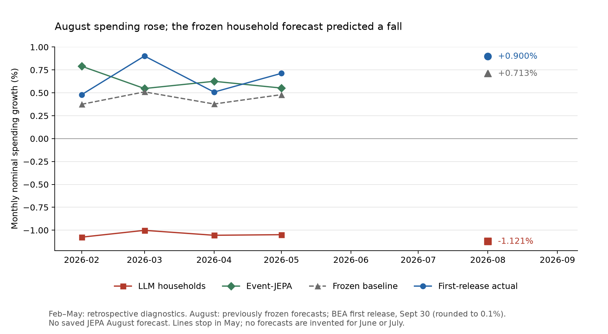

# Recovered evidence and August forecast score — 2026-10-14

The frozen household forecast missed August spending direction and had more error
than its saved baseline. Event-JEPA had a
measured payroll gain in the old test, but it did not improve the primary spending
forecast. The archive contains real household purchase responses for a future test.

## What the JEPA lines showed

The green line is a separate macro forecast. It adds a learned correction to the
visible-data baseline. It does not use the LLM household policies as model inputs.
Calling it a JEPA-enriched household economy would give the wrong description.

On the four 2026 spending targets, JEPA beat the LLM household economy by a large
margin: RMSE 0.256 versus 1.703 percentage points. It nearly matched the baseline's
0.243. This was a small retrospective diagnostic, not a general forecasting win.

The restored 2024–2025 test gives a mixed result:

| Target | Event-JEPA RMSE | Latest-visible baseline RMSE | Best historical constant RMSE |
| --- | ---: | ---: | ---: |
| Nominal spending growth | 0.458 | 0.331 | 0.234 |
| Payroll growth | 0.054 | 0.060 | 0.062 |
| PCE price growth | 0.165 | 0.181 | 0.110 |

Units are percentage points. Payroll error was 10.8% lower than the latest-visible
baseline. This is a measured gain from one saved run, without a confidence interval
or repeat-seed result. Price forecasts beat the latest-growth baseline but lost to
a historical constant. JEPA did not win across the target set.

TRAIN ends in 2021. VALIDATION covers 2022–2023. TEST has 24 forecast origins from
January 2024 through December 2025, with next-month targets. Unemployment has 23
eligible rows. The four 2026 origins remain a separate development diagnostic.
Existing historical data have already been inspected; do not call them fresh
confirmation in a later experiment. Era-drift checks were not recovered for this
readout. The saved split contract and input vintages were verified.

Both saved score tables were recomputed from the recovered predictions. All 99 rows
matched to numerical tolerance. See [2026 scores](jepa_2026_scores.csv) and
[held-out scores](jepa_heldout_scores.csv).

## August first-release score

The forecast information cutoff was July 10. The tracked August 23 report already
recorded the -1.12% forecast before August's outcome was published. The information
cutoff is not a claim that the live model calls ran on July 10.

BEA released August outcomes on September 30, 2026. These scores use the rounded
monthly growth rates in [BEA 26–43](https://www.bea.gov/sites/default/files/2026-09/pi0826.pdf).
The outcome values have 0.1 percentage-point precision. The release includes an
annual revision; growth uses the preceding month in that same release.

| Target | Frozen household forecast | Frozen visible baseline | First release | Household absolute error | Baseline absolute error |
| --- | ---: | ---: | ---: | ---: | ---: |
| Nominal spending growth | -1.121% | +0.713% | +0.9% | 2.021 pp | 0.187 pp |
| Real spending growth | -1.478% | +0.262% | +0.6% | 2.078 pp | 0.338 pp |
| PCE price growth | +0.363% | +0.450% | +0.3% | 0.063 pp | 0.150 pp |
| Real disposable income growth | -0.340% | +0.251% | 0.0% | 0.340 pp | 0.251 pp |

The household forecast got nominal and real spending direction wrong. Its price
proxy was closer than the baseline. Only nominal spending has the close aggregate
mapping; the other outputs retain their declared proxy limitations. This is one
previously frozen forecast, not a multi-origin confirmatory study.

No JEPA August prediction exists. The origin state was incomplete when the forecast
was frozen. No prediction was regenerated after observing August. Five other macro
targets remain unscored in this append.



The original nine-panel chart remains the historical snapshot. Its August hollow
markers were unscored at creation; this new chart and score table supply the outcome.

## Full-period charts and interpretation

The project has mixed forecast evidence, rather than a blanket failure. Accounting
and settlement checks passed. JEPA produced a measured payroll gain. The household
spending point forecasts were less accurate than the visible-data baseline.
The code creates one `median` scenario, with no predictive interval or probability
distribution. Accounting bounds are not forecast uncertainty bounds. The saved
evidence therefore cannot support "the actual was inside the forecast interval."

The [full-period nine-panel chart](macro_forecast_scorecard.pdf) covers monthly target
observations over 2024–2026, with quarter labels. The
[2026 detail](macro_forecast_scorecard_2026.pdf) makes the household comparison easier
to read. Both use [portable plot data](macro_forecast_panel.csv), which remains local
after the raw files move back to Drive. Missing months are gaps. No earlier household
forecast or JEPA August point was invented. Other household metrics keep their
declared proxy mappings; credit is direction-only.

Rerender these charts from the portable CSV with
`python scripts/export_macro_scorecard.py`. Rebuilding that CSV with `--build-panel`
requires restoring the raw archives. `make review-saved-evidence` verifies portable
score tables when raw files are absent; it does not claim to verify an absent checkpoint.

## Recovery and verification

After this review, the updated raw inputs and checkpoint archive plus frozen-output
archive were stored in Strange Lab's `vei-shared` Drive. Full byte readback reported
six matching files and zero differences before local bulk removal. Charts, portable
plot data, and small reports remain local. The review bundle was refreshed with the
full-period nine-metric charts. Restore metadata accompanies each private archive.

The Strange Lab `vei-shared` archive was downloaded through the existing rclone
connection. Its 359,702,616 bytes match the saved October 8 receipt. All 16,262 safe
archive entries were restored under `work/`; no frozen output files were overwritten.
All 37 JEPA artifacts listed in its manifest match, including `model/model.pt`.
The restored checkpoint is 2,074,792 bytes. The original household output files
also match their manifest. No checkpoint inference, training, or LLM calls ran.

The append is under
`outputs/household_ecology_200_july_v24_current/realization_append/`. Its separate
receipt records the outcome source, dates, and errors. The original forecast
manifest and artifacts remain unchanged. The BEA release PDF is retained in
`work/realizations/august_2026/bea_pi0826.pdf`.

The scoring command now accepts selected verified targets and includes the saved
baseline. It does not require an invented employment or credit outcome to score PCE.
The JEPA make targets also stop deleting their event and checkpoint directories.
The existing CLI refuses a populated output directory. A later approved training
run must choose fresh output paths and its intended VEI runtime. The old runtime
remains pinned; the current VEI checkout is not silently substituted.

```sh
PATH=.venv/bin:$PATH make ecology-realize \
  REALIZATIONS_CSV=reports/august_2026_realizations.csv \
  REALIZATION_TARGETS='consumption_growth_pct real_consumption_growth_pct price_growth_pct real_disposable_income_growth_pct'
```

That append has already run; a second append is refused. To verify and regenerate
the derived tables and chart without modifying the frozen run:

```sh
PATH=.venv/bin:$PATH make review-saved-evidence
```

See [household response inventory](household_response_readiness.md) before proposing
new model calls. Publication is not approved; these changes remain local.
